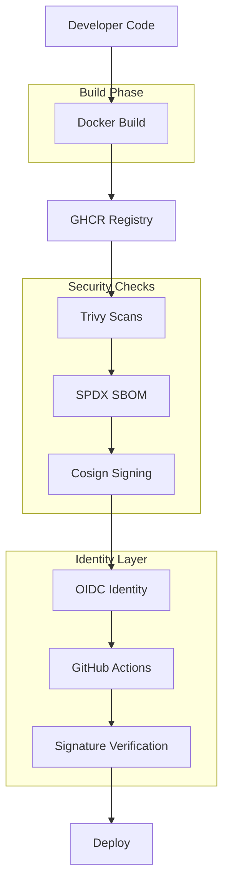

# Supply Chain Security Lab

## Goal & Platform Problem

This lab demonstrates modern DevSecOps practices for securing the software supply chain. The goal is to build, scan, sign, and verify a minimal Node.js application using industry-standard tooling.

**Platform Problem Addressed:**
- Modern software supply chains are complex, with dependencies spanning multiple registries and repositories
- Left-to-right attacks targeting CI/CD pipelines and artifact registries are increasing
- Organizations need verifiable provenance and transparency for all software artifacts
- Compliance frameworks (Executive Order 14028, NIST SP 800-218) mandate software bill of materials (SBOM) generation and artifact signing

**This lab shows:**
- Secure container image building with hardened base images and non-root users
- Automated vulnerability scanning at multiple stages (code, filesystem, image)
- SPDX SBOM generation for supply chain transparency
- Sigstore-based cryptographic signing and verification using OIDC

## Architecture



## Stack & Design Decisions

| Component | Choice | Rationale |
|-----------|--------|-----------|
| **Runtime** | Node.js 22 Alpine | Minimal attack surface, long-term support |
| **Container User** | Non-root `node` | Principle of least privilege |
| **Vulnerability Scanner** | Trivy | Comprehensive, CNCF project, supports multiple formats |
| **SBOM Format** | SPDX JSON | industry standard, OSI-approved, tooling support |
| **Signing** | Cosign + Sigstore | Keyless OIDC, GitHub Actions integration |
| **Registry** | GHCR (GitHub Container Registry) | Native integration with GitHub workflows |
| **Workflow** | GitHub Actions | CI/CD orchestration with native security features |

**Key Security Decisions:**
1. **Hardened base image**: `node:22-alpine` reduces attack surface vs full Ubuntu/Debian
2. **Non-root execution**: Container runs as `node` user (UID 1001), preventing container escape attacks
3. **Health checks**: Built-in Docker health checks enable orchestration integration
4. **Layered scanning**: Config + filesystem + image scans catch issues at multiple layers
5. **Keyless signing**: OIDC eliminates key management; signatures bind to GitHub workflow identity

## Quickstart & Local Validation

### Prerequisites
- Docker (24.x+)
- Trivy (0.48.x+)
- Node.js 18+ (for local validation)
- Make (optional)

### Build and Run Locally

```bash
# Clone the repository
git clone https://github.com/maximvalerevich/53-supply-chain-security-lab.git
cd 53-supply-chain-security-lab

# Validate configuration files
make validate

# Build the Docker image
make build

# Run container and smoke test
make up

# Run security scans
make scan

# Generate SBOM
make sbom
```

### Manual Verification

```bash
# Start container manually
docker build -t supply-chain-security-lab:latest -f app/Dockerfile app
docker run -d -p 8080:8080 --name supply-chain-lab supply-chain-security-lab:latest

# Test endpoints
curl http://localhost:8080/healthz
curl http://localhost:8080/

# Cleanup
docker stop supply-chain-lab && docker rm supply-chain-lab
```

## Evidence

Evidence files are generated by the security workflows and scan scripts:

| Evidence | Path | Description |
|----------|------|-------------|
| 01 - SBOM | `evidence/sbom.spdx.json` | Software Bill of Materials (SPDX JSON) |
| 02 - Container Image Scan | `evidence/image-scan.txt` | Trivy container scan results |
| 03 - Filesystem Scan | `evidence/fs-scan.txt` | Trivy filesystem scan results |
| 04 - Image Artifact | `ghcr.io/${owner}/supply-chain-security-lab:latest` | Signed container image |
| 05 - Workflow Run | GitHub Actions run logs | CI/CD execution evidence |

**View evidence:**
- SBOM: `cat evidence/sbom.spdx.json | jq .` (requires jq)
- Image scan: `trivy image supply-chain-security-lab:latest`
- Filesystem scan: `trivy fs app`

## Failure Modes & Troubleshooting

| Issue | Symptom | Resolution |
|-------|---------|------------|
| **Container fails to start** | `docker ps` shows no running container | Check logs: `docker logs supply-chain-lab` |
| **Health check fails** | `/healthz` returns 500 or timeout | Verify `server.js` syntax: `node --check app/server.js` |
| **Trivy not found** | `command not found: trivy` | Install: `curl -sfL https://raw.githubusercontent.com/aquasecurity/trivy/main/contrib/install.sh \| sh -s -- -b /usr/local/bin` |
| **Cosign verification fails** | `Error: image not signed` | Ensure `cosign sign --yes` succeeded in workflow; check sigstore logs |
| **SBOM generation fails** | Missing `evidence/sbom.spdx.json` | Run: `trivy fs --input app --format spdx-json -o evidence/sbom.spdx.json` |

**Common Issues:**
- **Port already in use**: Container on port 8080 conflicts with existing service → `docker stop <existing-container>`
- **Docker permission denied**: Add user to docker group or use sudo
- **GitHub token permission errors**: Ensure workflow has `packages: write` and `id-token: write` permissions

## Cost & Cleanup

### Local Development Costs
- **Disk space**: ~200MB for Alpine-based image, ~500MB with cache
- **Memory**: ~50MB runtime memory usage
- **Network**: Minimal (only for pulling base image)

### CI/CD Costs (GitHub Actions)
- **Free tier**: 2,000 minutes/month for public repositories
- **Estimated usage**: ~5 minutes per workflow run × 40 runs = 200 minutes/month
- **Cost**: $0 on public repos (within free tier); $0.008/minute on private repos

### Cleanup Commands

```bash
# Stop and remove container
docker stop supply-chain-lab && docker rm supply-chain-lab

# Remove dangling images
docker image prune -f

# Clean Trivy cache
trivy image --clear-cache

# Remove local images
docker rmi supply-chain-security-lab:latest ghcr.io/*/*:latest
```

### Resource Cleanup Checklist
- [ ] Stop running containers: `make down`
- [ ] Remove unused images: `docker image prune -a`
- [ ] Clear Trivy cache: `trivy image --clear-cache`
- [ ] Remove SBOM files: `rm evidence/sbom.spdx.json` (if not needed)

---

*This lab is for educational purposes. Do not use in production without additional hardening.*
